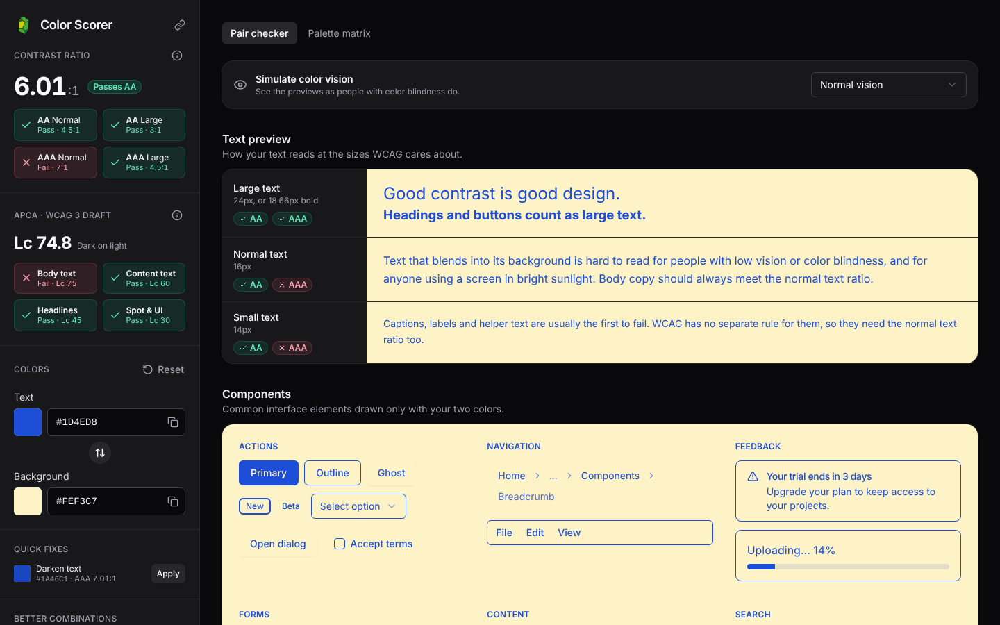
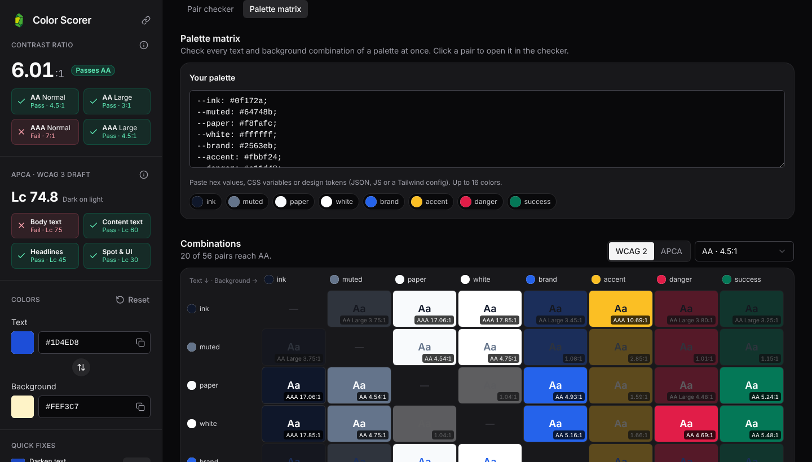
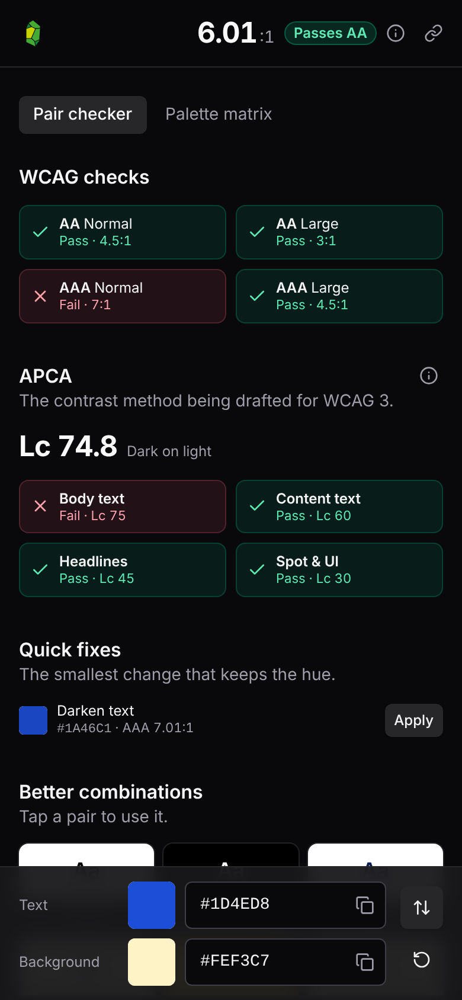

# Color Scorer - WCAG Contrast Ratio Checker

   

Color Scorer is a web application built with React and TypeScript that helps designers and developers check contrast ratios between colors according to WCAG (Web Content Accessibility Guidelines) standards.

## Screenshots



---



## Features

- Compare a text and a background color for accessibility compliance
- WCAG 2 contrast ratio with pass/fail checks for AA and AAA, for normal and large text
- APCA lightness contrast (the method drafted for WCAG 3) side by side, with a note when the two disagree
- Quick fixes: the smallest lightness change that reaches AA or AAA while keeping the hue
- Color blindness simulation (protanopia, deuteranopia, tritanopia and achromatopsia) with the contrast as seen
- Palette matrix: paste a palette (hex list, CSS variables or design tokens) and check every pair at once
- Text preview at the sizes WCAG cares about (24px, 16px and 14px)
- Common UI components drawn only with your two colors
- Color pickers with hex input, copy buttons and transparency support
- Suggestions for better color combinations, one click to apply
- Shareable links: colors, palettes and pages are kept in the URL (`?text=1d4ed8&bg=fef3c7`)
- Works on desktop and mobile
- A small easter egg if you pick a Pantone Color of the Year

## How the score is calculated

The contrast ratio follows the [WCAG 2.x definition](https://www.w3.org/TR/WCAG22/#dfn-contrast-ratio):

1. Each color is converted to its relative luminance `L` (sRGB channels linearized, then `0.2126 R + 0.7152 G + 0.0722 B`).
2. The ratio is `(L1 + 0.05) / (L2 + 0.05)`, where `L1` is the lighter color. It goes from `1:1` (same color) to `21:1` (black on white).
3. Translucent colors are blended before scoring: the background is placed on a white page, and the text on top of that background. The preview is drawn with these blended colors, so what you see is exactly what is scored.
4. The ratio is truncated to two decimals, so a failing `4.499` is shown as `4.49` and never rounded up to a passing `4.50`.

| Level | Normal text | Large text |
| ----- | ----------- | ---------- |
| AA    | 4.5:1       | 3:1        |
| AAA   | 7:1         | 4.5:1      |

Large text is 24px (18pt) and up, or 18.66px (14pt) bold and up.

### APCA

[APCA](https://github.com/Myndex/apca-w3) is the contrast method being drafted for WCAG 3. Instead of a ratio it gives a lightness contrast (Lc) from 0 to about 106, and it is polarity aware: dark text on a light background is scored differently than light text on a dark one. Color Scorer uses the APCA-W3 0.0.98G constants and shows these simplified levels:

| Lc  | Use                                         |
| --- | ------------------------------------------- |
| 75  | Body text, 18px regular and up              |
| 60  | Content text, 24px regular or 16px bold     |
| 45  | Headlines, 36px regular or 24px bold        |
| 30  | Spot text and UI: placeholders, icons, etc. |

WCAG 2 tends to overrate contrast between dark colors and underrate light text on saturated mid tones, so the app points out pairs where the two methods disagree. APCA is still a draft; WCAG 2 is the standard to meet today.

### Color blindness simulation

Colors are simulated with the matrices from Machado, Oliveira and Fernandes (2009) at full severity, applied in linear RGB. Because the preview only uses the two picked colors, simulating the pair is exact, and the contrast is measured again on the simulated colors.

## Architecture

The application uses a modern React architecture with the following key components:

- **State Management**: TanStack Store for efficient state updates (`src/store`)
- **Color Logic**: Framework free, unit tested helpers for parsing colors, WCAG and APCA contrast, fixes, vision simulation, palettes and suggestions (`src/lib`)
- **UI Components**: Leveraging Shadcn for accessible UI components. Inside the preview the theme tokens are remapped to the tested colors, so every component uses only that pair

## Run Locally

To run this application locally:

```bash
# Install dependencies
pnpm install

# Start the development server
pnpm run dev
```

Then open [http://localhost:3001/color-scorer](http://localhost:3001/color-scorer) in your browser to see the application running.

## Building For Production

To build the application for production:

```bash
pnpm build
```

The build artifacts will be stored in the `dist/` directory.

## Scripts

| Command             | Description                                  |
| ------------------- | -------------------------------------------- |
| `pnpm dev`          | Start the development server                 |
| `pnpm build`        | Type check and build for production          |
| `pnpm test`         | Run the unit tests                           |
| `pnpm lint`         | Lint the code with ESLint                    |
| `pnpm format`       | Format the code with Prettier                |
| `pnpm format:check` | Check the formatting without changing files  |
| `pnpm deploy`       | Publish `dist/` to GitHub Pages (`gh-pages`) |

Every push and pull request runs the format check, lint, tests and build on GitHub Actions.

## Releasing

The site is deployed to GitHub Pages only when a version tag is pushed. Versions follow [SemVer](https://semver.org/):

```bash
# bump the version in package.json, commit, then tag and push
git tag v1.1.0
git push origin v1.1.0
```

## Tech Stack

- [React 19](https://react.dev/)
- [TypeScript](https://www.typescriptlang.org/) - Type safety
- [TanStack Router](https://tanstack.com/router) - Routing
- [TanStack Store](https://tanstack.com/store) - State management
- [Tailwind CSS](https://tailwindcss.com/) - Styling
- [Shadcn UI](https://ui.shadcn.com/) - UI components
- [Vitest](https://vitest.dev/) - Unit tests

## Contributing

Contributions are welcome! Please feel free to submit a Pull Request.

## Responsive Design

On phones the sidebar turns into a header with the score and a bottom panel with both colors.


